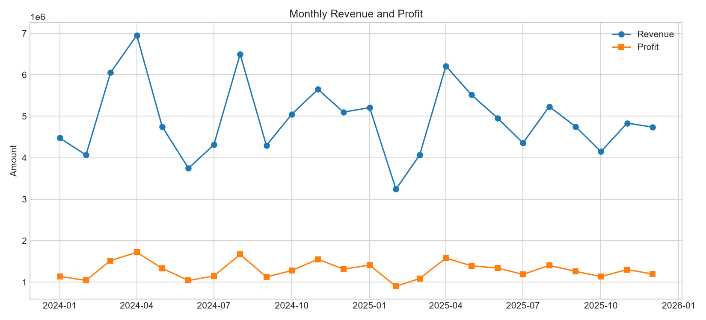
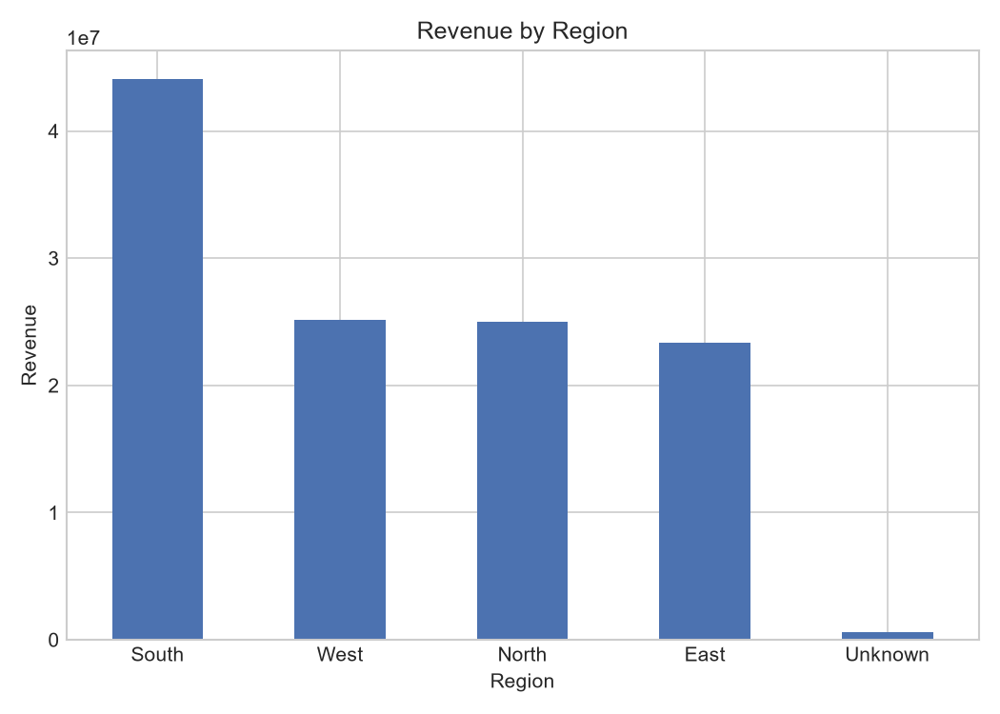
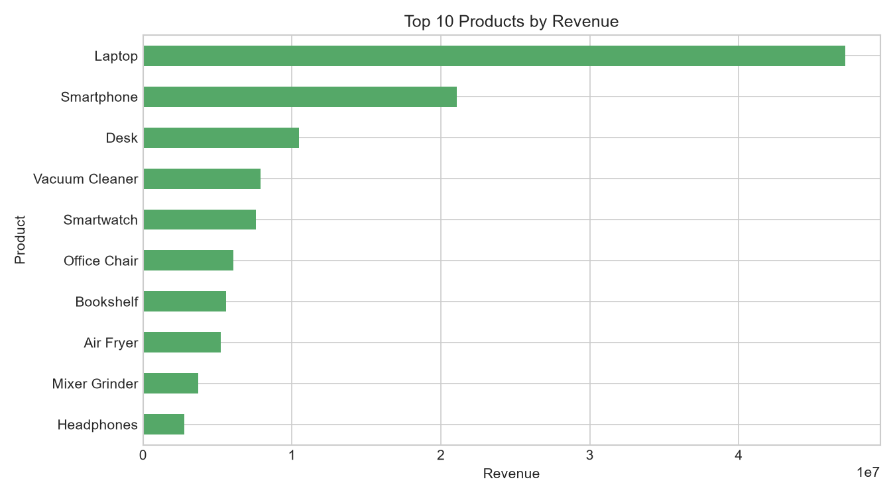

# Sales Analysis Project

An end-to-end sales analytics pipeline in Python. One script loads a sales dataset, cleans it, calculates business KPIs, and automatically saves charts, an Excel report and a text summary.

## Problem Statement

A retail business records every order but has no automated way to turn raw data into insights. This project answers questions such as:

- What are the total revenue, profit and profit margin?
- Which regions, categories and products perform best?
- How do sales change month to month, and which weekday is strongest?
- Who are the top customers?

## Features

- Data cleaning (duplicates, missing values, invalid rows)
- KPI calculation: Revenue, Cost, Profit, Margin %, Average Order Value, MoM growth
- Breakdowns by region, category, product, customer, month and weekday
- 6 charts saved as PNG
- Multi-sheet Excel report, cleaned CSV and text summary
- Auto-generates sample data if no dataset is provided

## Tech Stack

| Tool | Purpose |
|---|---|
| Python 3.10+ | Core language |
| pandas | Cleaning and aggregation |
| NumPy | Numerical work, sample data |
| Matplotlib | Charts |
| openpyxl | Excel report |

## Project Structure

```
Sales_analysis_project/
├── sales_analysis.py                  # main script
├── requirements.txt                   # dependencies
├── README.md
├── Sales_Analysis_Project_Report.pdf  # full project report
├── data/
│   └── sales_data.csv                 # input dataset
└── output/
    ├── cleaned_sales_data.csv
    ├── sales_report.xlsx
    ├── summary.txt
    └── charts/
```

## How to Run

```bash
# 1. Clone the repository
git clone https://github.com/<varsha-j-06>/sales-analysis-project.git
cd sales-analysis-project

# 2. Install dependencies
pip install -r requirements.txt

# 3. Run the analysis
python sales_analysis.py
```

Results are saved in the `output/` folder.

### Using your own data

Replace `data/sales_data.csv` with a CSV that has these columns:

`Order ID, Order Date, Customer, Region, Category, Product, Quantity, Unit Price, Discount, Unit Cost`

## Sample Results

The included dataset is **synthetic test data**, so these numbers demonstrate the method only.

| KPI | Value |
|---|---|
| Total Revenue | 118,196,205 |
| Total Profit | 31,082,695 |
| Profit Margin | 26.30% |
| Total Orders | 3,000 |
| Best Region | South |
| Best Category | Electronics |
| Best Product | Laptop |

### Charts





## Future Improvements

- Connect to a live database (MySQL / PostgreSQL)
- Interactive dashboard (Power BI, Tableau or Streamlit)
- Sales forecasting (ARIMA / Prophet)
- Customer segmentation (RFM analysis)

## Author

**Varsha J**
GitHub: varsha-j-06 (https://github.com/varsha-j-06)
